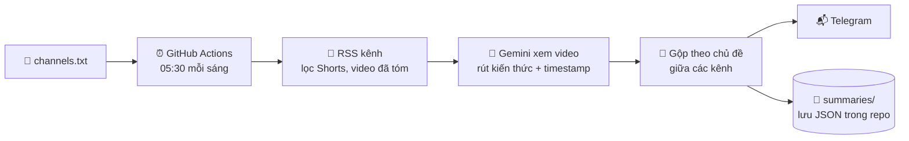

<div align="center">

# 📺 YT Digest

### Theo dõi 10 kênh YouTube. Đọc 15 phút mỗi sáng. Không cần xem video nào.

AI "xem" video mới từ các kênh bạn theo dõi, rút ra **kiến thức cốt lõi** (con số, công thức, công cụ, các bước)<br>
và gửi về **Telegram** lúc 05:30 sáng. Chạy hoàn toàn trên GitHub Actions + Gemini free tier: **0 đồng, 0 server**.

[](https://github.com/buiminhdn/yt-digest/actions/workflows/digest.yml)


[Cài đặt 15 phút](#-cài-đặt-15-phút) · [Ví dụ đầu ra](#-mỗi-sáng-bạn-nhận-được-gì) · [Cách hoạt động](#️-cách-hoạt-động) · [Tùy chỉnh](#️-tùy-chỉnh) · [English](#-english-tldr)

</div>

---

## 🤔 Vấn đề

Bạn theo dõi hàng chục kênh hay về AI, tài chính, kinh doanh… Mỗi tuần có 30+ video mới, mỗi video 20–60 phút.
Bạn không có 15 tiếng/tuần để xem hết, nên hoặc bỏ lỡ kiến thức, hoặc để "Xem sau" chất thành núi.

**YT Digest giải quyết đúng một việc:** biến hàng giờ video thành vài phút đọc, mà vẫn giữ lại phần giá trị nhất.

## ✨ Điểm khác biệt

| | Tóm tắt thông thường | **YT Digest** |
|---|---|---|
| Nội dung | *"Video này giới thiệu về…"* | Viết thẳng **kiến thức**: con số, công thức, công cụ, các bước |
| Độ dài | Lan man hoặc quá sơ sài | Có trần chữ theo độ dài video (150 / 300 / 400 chữ) |
| Nhiều kênh | Mỗi video một bản rời rạc | **Gộp chủ đề trùng** giữa các kênh thành một mục |
| Định vị | Không biết ý nằm ở đâu | Mỗi phần có **timestamp** (khớp chương của tác giả ±1 giây) |
| Vận hành | Copy link, dán vào chatbot, chờ | **Tự động 100%**: chỉ cần dán link kênh một lần |
| Chi phí | Thuê bao hàng tháng | **0đ**: GitHub Actions + Gemini free tier |

Không cần transcript, không cần server, không cần máy bật: Gemini đọc thẳng URL YouTube (cả hình lẫn tiếng), nên dùng được cả với video không có phụ đề.

## 📬 Mỗi sáng bạn nhận được gì

Tin Telegram thật từ một lượt chạy (rút gọn):

```text
📺 YT Digest · Thứ Năm, 05/11/2026
1 video mới · 1 kênh

💡 KIẾN THỨC NỔI BẬT
• Sử dụng 7 skill Claude Code giúp tự động hóa 80% công việc kinh doanh
  và lập trình mà không cần biết code.

📝 GHI CHÚ CHI TIẾT TỪNG VIDEO

7 Skills Giúp Claude Thực Sự "Nguy Hiểm"
Nhat Anh AI

▸ Scroll Craft & Marketing (01:10)
• Scroll Craft giúp Claude tạo website độc đáo với bố cục riêng biệt dựa trên yêu cầu sản phẩm.
• Bộ marketing skills kết hợp Fal.ai giúp lên ý tưởng, kịch bản và tạo video quảng cáo bằng AI.

▸ HyperFrames & Apify (18:11)
• Apify MCP Server cho phép Claude trích xuất dữ liệu từ Google Maps, TikTok chỉ trong vài phút.

▸ Playwright & Last30Days (26:02)
• Playwright cho phép Claude thao tác trực tiếp trên trình duyệt như một người dùng thực sự.
• Last30Days tổng hợp ý kiến từ Reddit, X, YouTube để nghiên cứu cộng đồng trong 30 ngày qua.
```

Video 40 phút → đọc 1 phút. Muốn đào sâu phần nào thì bấm vào tiêu đề và tua đến đúng timestamp.

Ngày có nhiều video, bản tin có thêm mục **🧭 Tổng hợp theo chủ đề**, gom ý từ nhiều kênh cùng nói về một vấn đề.

## ⚙️ Cách hoạt động



Một vài chi tiết kỹ thuật đáng chú ý:

- **Bền với lỗi:** RSS của YouTube thỉnh thoảng trả 404, hệ thống thử lại rồi chuyển sang đọc trang `/videos`. Một kênh hay một video lỗi không làm hỏng cả lượt chạy; tiến độ được lưu sau mỗi video.
- **Tiết kiệm quota:** lấy mẫu 0.2 khung hình/giây ở độ phân giải thấp. Video nói chuyện không cần nhiều hình hơn.
- **Model fallback:** model đầu hết quota hoặc quá tải thì tự chuyển sang model kế tiếp. Hết hẳn quota thì dừng và để phần còn lại cho hôm sau.
- **Đầu ra có schema:** Gemini trả JSON được kiểm tra bằng pydantic, không phải văn bản tự do.
- **Tự thử lại:** video riêng tư, livestream chưa xong… được thử lại tối đa 3 lần rồi báo ở mục "Không tóm tắt được".

## 🚀 Cài đặt (15 phút)

Bạn cần: một tài khoản GitHub, một tài khoản Google, và Telegram. Không cần biết code.

### 1. Lấy Gemini API key (miễn phí)
Vào [aistudio.google.com/apikey](https://aistudio.google.com/apikey), bấm **Create API key** rồi copy key.

### 2. Tạo bot Telegram
1. Mở Telegram, tìm **@BotFather**, gõ `/newbot`, đặt tên. Bạn nhận được **token** dạng `123456:ABC...`.
2. Mở bot vừa tạo và nhắn cho nó một tin bất kỳ (ví dụ "hi").
3. Lấy chat ID bằng một trong hai cách:
   - Mở trình duyệt: `https://api.telegram.org/bot<TOKEN>/getUpdates`, tìm `"chat":{"id": 123456789`
   - Hoặc chạy: `python digest/get_chat_id.py <TOKEN>`

### 3. Fork repo này
Bấm **Fork** ở góc trên bên phải. Sau đó dọn dữ liệu của chủ repo gốc:
- Xóa nội dung thư mục `summaries/` và hai file trong `state/` (hoặc để nguyên, hệ thống vẫn chạy, chỉ là lẫn ghi chú cũ).
- Thay danh sách trong `channels.txt` bằng kênh của bạn.

> GitHub tắt lịch chạy tự động trên repo fork. Vào tab **Actions** và bấm **I understand my workflows, go ahead and enable them**.

### 4. Thêm 3 secret
Vào repo → **Settings → Secrets and variables → Actions → New repository secret**:

| Tên | Giá trị |
|---|---|
| `GEMINI_API_KEY` | key ở bước 1 |
| `TELEGRAM_BOT_TOKEN` | token ở bước 2 |
| `TELEGRAM_CHAT_ID` | chat ID ở bước 2 |

### 5. Dán link kênh
Sửa `channels.txt` (sửa thẳng trên web GitHub hoặc app GitHub trên điện thoại cũng được). Mỗi dòng một link, chấp nhận mọi dạng:

```text
https://www.youtube.com/@tenkenh
https://www.youtube.com/channel/UCxxxxxxxxxxxxxxxxxxxxxx
@tenkenh
```

### 6. Chạy thử
**Actions → YouTube Digest → Run workflow**. Vài phút sau Telegram báo về.
Từ đó trở đi, hệ thống tự chạy lúc **05:30 mỗi sáng**. Bạn chỉ việc đọc.

## 📖 Dùng hằng ngày

- **Đọc:** "Kiến thức nổi bật" → "Tổng hợp theo chủ đề" → ghi chú chi tiết của video bạn muốn đào sâu.
- **Thêm hoặc bớt kênh:** sửa `channels.txt`.
- **Xem lại ngày cũ:** cuộn lại Telegram, hoặc mở JSON trong `summaries/YYYY-MM-DD/`. Sau vài tháng, đây là một kho kiến thức có cấu trúc của riêng bạn.

## 🛠️ Tùy chỉnh

Mọi thứ nằm trong `config.yaml`:

| Mục | Ý nghĩa |
|---|---|
| `language` | Ngôn ngữ tóm tắt (mặc định Tiếng Việt, đổi sang `English` cũng được) |
| `models` | Danh sách model Gemini, thử lần lượt từ trên xuống |
| `lookback_days` | Lần đầu chỉ lấy video trong N ngày gần nhất |
| `max_videos_per_run` | Giới hạn số video mỗi ngày |
| `skip_shorts` | Bỏ qua Shorts |
| `video_fps`, `low_resolution` | Tiết kiệm token. Tăng `video_fps` (ví dụ `1`) nếu kênh nặng về demo màn hình |
| `max_attempts` | Số lần thử lại một video lỗi |
| `telegram_detail` | `full` = cả digest, `short` = chỉ kiến thức nổi bật + danh sách link |

- **Đổi giờ chạy:** sửa dòng `cron` trong [.github/workflows/digest.yml](.github/workflows/digest.yml). Giờ ở đây là UTC (giờ VN trừ 7).
- **Đổi phong cách tóm tắt:** sửa `VIDEO_PROMPT` và `DIGEST_PROMPT` trong [digest/summarize.py](digest/summarize.py).

## 💻 Chạy trên máy

```bash
pip install -r requirements.txt
python digest/main.py --fake --no-telegram          # tóm tắt giả lập, kiểm tra luồng, không cần key
GEMINI_API_KEY=... python digest/main.py --no-telegram
```

Cấu trúc code gọn, mỗi file một việc:

```text
digest/
├── main.py         # điều phối: tìm video → tóm tắt → tổng hợp → gửi → lưu
├── youtube.py      # link kênh → channel ID → RSS (fallback trang /videos), lọc Shorts
├── summarize.py    # prompt + schema + gọi Gemini, model fallback
├── notify.py       # dựng tin Telegram (HTML), chia tin dài
└── get_chat_id.py  # tiện ích lấy TELEGRAM_CHAT_ID
```

## ❓ Câu hỏi thường gặp

<details>
<summary><b>Có thật sự miễn phí không?</b></summary>

Có, trong giới hạn: repo public được dùng GitHub Actions miễn phí; Gemini free tier cho tối đa khoảng **8 giờ video YouTube mỗi ngày**. Hết quota thì phần còn lại tự dời sang hôm sau. Theo dõi ~10 kênh thường không chạm giới hạn này.
</details>

<details>
<summary><b>Video không có phụ đề thì sao?</b></summary>

Vẫn chạy. Gemini xử lý trực tiếp hình và tiếng của video qua URL, không dựa vào transcript.
</details>

<details>
<summary><b>Tóm tắt bằng tiếng Anh hoặc ngôn ngữ khác được không?</b></summary>

Được. Đổi `language` trong `config.yaml`. Video nguồn ở ngôn ngữ nào cũng được.
</details>

<details>
<summary><b>Tôi muốn giữ kín danh sách kênh và ghi chú</b></summary>

Chuyển repo sang private. Hệ thống vẫn chạy bình thường, chỉ là tiêu phút Actions trong hạn mức free của gói GitHub (2.000 phút/tháng với tài khoản free; mỗi lượt thường chỉ mất vài phút).
</details>

<details>
<summary><b>Những video nào không tóm tắt được?</b></summary>

Video riêng tư, chỉ dành cho hội viên, hoặc livestream chưa kết thúc. Chúng được thử lại tối đa 3 lần rồi liệt kê ở mục "Không tóm tắt được" trong tin Telegram.
</details>

<details>
<summary><b>Tin Telegram đến trễ?</b></summary>

Lịch chạy của GitHub Actions có thể trễ 5–30 phút so với giờ đặt, nhất là giờ cao điểm. Đây là giới hạn của GitHub.
</details>

## 🗺️ Lộ trình

- [x] Tóm tắt kiến thức cốt lõi kèm timestamp
- [x] Gộp chủ đề giữa nhiều kênh
- [x] Fallback khi RSS lỗi, fallback model khi hết quota
- [ ] Hỏi đáp trên toàn bộ kho ghi chú đã lưu
- [ ] Thêm / bớt kênh bằng lệnh Telegram bot

Có ý tưởng? Mở [issue](https://github.com/buiminhdn/yt-digest/issues) hoặc gửi pull request.

## 🤝 Đóng góp

Mọi đóng góp đều được hoan nghênh: sửa lỗi, cải thiện prompt, thêm kênh gửi tin (Discord, Slack, email…).
Trước khi gửi PR, hãy chạy `python digest/main.py --fake --no-telegram` để chắc luồng vẫn chạy.

Nếu YT Digest giúp bạn tiết kiệm được vài giờ mỗi tuần, hãy cho repo một ⭐ để nhiều người khác tìm thấy.

---

## 🌍 English TL;DR

**YT Digest** watches the YouTube channels you follow and sends you a daily **knowledge digest on Telegram**, not "this video is about…" blurbs, but the actual key facts, numbers, tools and steps, with timestamps. It merges overlapping topics across channels so a 3-hour backlog becomes a 15-minute read.

- Runs entirely on **GitHub Actions + Gemini free tier**: no server, no cost.
- No transcripts needed: Gemini reads the YouTube URL directly (video + audio).
- Setup: fork → add `GEMINI_API_KEY`, `TELEGRAM_BOT_TOKEN`, `TELEGRAM_CHAT_ID` secrets → paste channel links into `channels.txt` → enable Actions.
- Change `language` in `config.yaml` to get digests in English or any other language.
